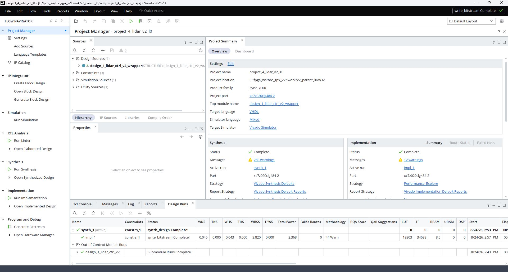
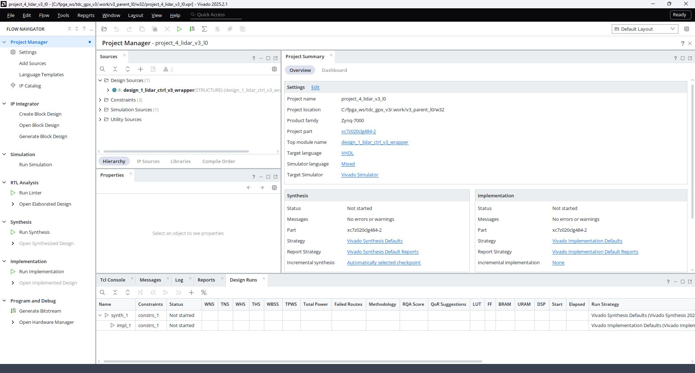
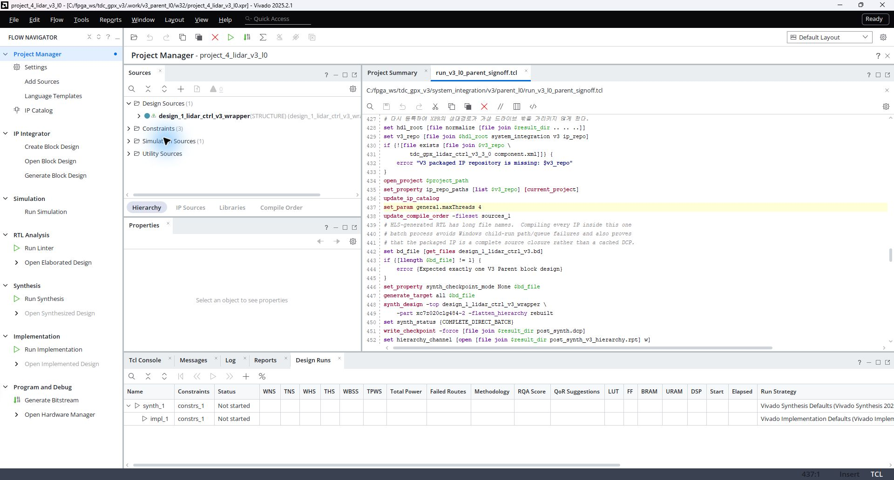
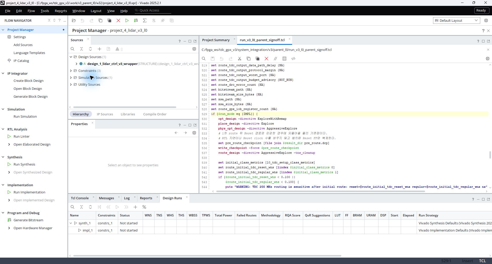

# V2/V3 Vivado 합성 및 구현 설정 기록

## 1. 문서 목적

이 문서는 `tdc_gpx_lidar_ctrl` V2와 V3 Parent 프로젝트가 Vivado 기본 합성·구현
설정에서 무엇을 변경했는지 기록한다. 또한 Vivado GUI에 보이는 Run 설정과 실제
Sign-off 설정이 일치하는지 판단하는 방법을 설명한다.

- 확인 도구: Vivado 2025.2.1
- 확인일: 2026-08-24
- 대상 FPGA: `xc7z020clg484-2`
- 32-bit와 64-bit Profile은 같은 합성·구현 전략을 사용한다.
- `G_OUTPUT_WIDTH`와 연결된 AXI4-Stream/VDMA 폭만 Profile별로 달라진다.

## 2. 핵심 결론

| 구분 | V2 | V3 |
|---|---|---|
| 합성 실행 방식 | Vivado Project Run `synth_1` | Tcl 직접 실행 `synth_design` |
| 합성 전략 | `Vivado Synthesis Defaults` | 전체 Block Design 직접 합성 |
| 구현 실행 방식 | Vivado Project Run `impl_1` | Tcl 직접 `opt/place/phys_opt/route` 실행 |
| 구현 전략 | `Performance_Explore` | 단계별 비기본 directive와 조건부 재배선 |
| GUI Design Runs | 실제 실행 결과를 표시 | 기본 Run은 `Not started`로 남음 |
| 최종 결과 | `.runs/synth_1`, `.runs/impl_1` | `post_synth.dcp`, `post_route.dcp`, BIT, XSA |

V2에서는 Parent `.xpr`의 Project Summary와 Design Runs가 실제 Sign-off 실행 상태를
표시한다. V3에서는 Parent `.xpr`가 편집 가능한 설계 원본이고, 실제 Sign-off는 별도
Tcl 흐름이 수행한다. 따라서 V3 Project Summary에 보이는 기본 전략과 `Not started`
상태를 최종 Sign-off 상태로 해석하면 안 된다.

## 3. V2 GUI 및 실제 설정

### 3.1 Project Summary



화면에서 다음 정보를 확인할 수 있다.

- Synthesis Strategy: `Vivado Synthesis Defaults`
- Implementation Strategy: `Performance_Explore`
- `synth_1`: `synth_design Complete!`
- `impl_1`: `write_bitstream Complete!`

V2의 GUI 표시값은 실제 실행한 Project Run과 일치한다.

### 3.2 V2 합성 설정

합성 전략은 Vivado 기본값을 유지한다. 하위 Block Design IP도 기본 Out-of-Context
(OOC) Run으로 합성되고, 최상위 `synth_1`이 하위 DCP를 연결한다.

```tcl
reset_run synth_1
launch_runs synth_1 -jobs 8
wait_on_run synth_1
```

`-jobs 8`은 동시 작업 수를 정하는 실행 자원 옵션이다. 합성 논리의 최적화 전략을
변경하는 옵션은 아니다.

### 3.3 V2 구현 설정

V2는 Vivado 기본 구현 전략 대신 `Performance_Explore`를 사용한다.

```tcl
set_property strategy Performance_Explore [get_runs impl_1]
launch_runs impl_1 -to_step write_bitstream -jobs 8
```

Vivado 2025.2.1의 실제 실행 로그에서 확인한 단계별 directive는 다음과 같다.

| 구현 단계 | 실제 directive |
|---|---|
| `opt_design` | `Explore` |
| `place_design` | `Explore` |
| `phys_opt_design` | `Explore` |
| `route_design` | `Explore` |

권위 있는 설정원은 다음 파일이다.

```text
system_integration/v2/parent_l0/run_v2_l0_parent_signoff.tcl
```

## 4. V3 GUI와 실제 Sign-off 설정의 차이

### 4.1 Parent Project Summary



V3 Parent `.xpr`를 일반적으로 열면 다음과 같이 표시된다.

- Synthesis Strategy: `Vivado Synthesis Defaults`
- Implementation Strategy: `Vivado Implementation Defaults`
- `synth_1`: `Not started`
- `impl_1`: `Not started`

이 화면은 V3 Sign-off가 수행되지 않았다는 의미가 아니다. V3는 Project Run을
실행하지 않고 동일 Vivado 세션 안에서 합성·배치·배선을 직접 수행하기 때문에 Run
데이터베이스가 갱신되지 않는다.

### 4.2 V3 직접 합성 설정



Vivado GUI에서 다음 경로로 실제 설정원을 확인할 수 있다.

1. `File > Text Editor > Open File...`
2. `system_integration/v3/parent_l0/run_v3_l0_parent_signoff.tcl` 열기
3. `Ctrl+G`를 눌러 437번 줄 부근으로 이동

실제 합성 설정은 다음과 같다.

```tcl
set_param general.maxThreads 4
set_property synth_checkpoint_mode None $bd_file
generate_target all $bd_file
synth_design -top design_1_lidar_ctrl_v3_wrapper \
    -part xc7z020clg484-2 -flatten_hierarchy rebuilt
write_checkpoint -force $result_dir/post_synth.dcp
```

각 설정의 목적은 다음과 같다.

| 설정 | 분류 | 목적 |
|---|---|---|
| `general.maxThreads 4` | 실행 자원 | Vivado 내부 병렬 Thread 수 제한 |
| `synth_checkpoint_mode None` | 합성 구조 | 하위 IP OOC DCP 대신 전체 소스를 한 세션에서 합성 |
| `generate_target all` | IP 생성 | Block Design과 하위 IP 생성물 준비 |
| `flatten_hierarchy rebuilt` | 합성 구조 | 계층을 최적화한 뒤 디버깅 가능한 형태로 재구성 |
| `post_synth.dcp` | 결과 보존 | GUI Run과 독립된 합성 Sign-off Checkpoint |

V3가 전체 직접 합성을 사용하는 주된 이유는 HLS 생성 RTL의 긴 파일명으로 인한
Windows 하위 Run 경로·Queue 실패를 피하고, 캐시된 DCP가 아닌 패키지 전체 Source
Closure를 검증하기 위해서다.

### 4.3 V3 직접 구현 설정



동일 파일의 529번 줄 부근에서 실제 구현 directive를 확인할 수 있다.

```tcl
opt_design      -directive ExploreWithRemap
place_design    -directive Explore
phys_opt_design -directive AggressiveExplore
route_design    -directive AggressiveExplore -tns_cleanup
```

모두 Vivado 기본 구현 설정보다 적극적인 타이밍 최적화 설정이다.

첫 배선 후 TDC 200 MHz Reset 경로 또는 일반 상태·데이터 경로의 Setup 여유가
`0.100 ns`보다 작으면 다음 조건부 물리 최적화를 추가 수행한다.

1. 배치가 끝난 `pre_route.dcp`로 복귀한다.
2. TDC Reset과 Phase 고팬아웃 Net을 물리 복제한다.
3. `AggressiveExplore -tns_cleanup`으로 다시 배선한다.
4. 최종 TDC 200 MHz Reset 경로와 일반 상태·데이터 경로가 각각 `0.100 ns` 이상인지
   다시 검사한다.

최신 2026-08-24 실행에서는 다음과 같이 적용됐다.

| Profile | 첫 배선 판정 | 조건부 Net 복제 |
|---|---|---|
| V3 32-bit | Reset 경로가 기준 미달 | Reset/Phase 복제 후 재배선 |
| V3 64-bit | 첫 배선에서 기준 만족 | 적용하지 않음 |

이는 RTL 또는 Generic 차이가 아니라 첫 배치·배선 결과에 따라 선택되는 구현 단계다.

## 5. 결과 확인 위치

### 5.1 V2

V2는 Parent 프로젝트 안에서 결과를 확인한다.

```text
32-bit: .work/v2_parent_l0/w32/project_4_lidar_v2_l0.xpr
64-bit: .work/v2_parent_l0/w64/project_4_lidar_v2_l0.xpr
```

GUI 확인 순서:

1. `Project Summary`에서 Synthesis/Implementation Strategy를 확인한다.
2. `Design Runs`에서 `synth_1`과 `impl_1` 완료 상태를 확인한다.
3. `Open Synthesized Design` 또는 `Open Implemented Design`을 실행한다.

### 5.2 V3

V3 Parent `.xpr`는 Block Design과 Source 유지보수에 사용한다. 최종 물리 결과는
Sign-off Checkpoint를 열어 확인한다.

```text
32-bit project: .work/v3_parent_l0/w32/project_4_lidar_v3_l0.xpr
32-bit result : .work/v3_parent_signoff/260824_v3_w32_impl2/post_route.dcp

64-bit project: .work/v3_parent_l0/w64/project_4_lidar_v3_l0.xpr
64-bit result : .work/v3_parent_signoff/260824_v3_w64_impl2/post_route.dcp
```

V3 GUI에서 `Design Runs`의 `Not started`만 보고 구현 누락으로 판단하지 않는다.
`post_route.dcp`, `post_route_timing_summary.rpt`, BIT와 XSA가 모두 존재하고 Sign-off
요약의 PASS 조건을 만족해야 완료로 판정한다.

## 6. 유지보수 규칙

1. V2 구현 전략을 변경할 때는 `Performance_Explore` 설정과 실제 Run 로그의
   단계별 directive를 함께 확인한다.
2. V3의 Project Settings 화면에서 전략을 변경해도 직접 Sign-off 흐름에는 반영되지
   않는다. 반드시 `run_v3_l0_parent_signoff.tcl`을 수정해야 한다.
3. V3 직접 실행을 Project Run 방식으로 변경하려면 Windows 장경로, HLS 하위 IP
   생성, 조건부 Net 복제와 재배선 절차를 모두 다시 검증해야 한다.
4. 설정 변경 후 32-bit와 64-bit를 각각 합성·구현하고, Black Box, Latch, DRC,
   Setup/Hold, TDC 200 MHz 여유와 GPX IOB 배치를 다시 검사한다.
5. GUI 화면, Tcl 설정, Sign-off 결과가 서로 다른 Commit을 가리키지 않도록 결과
   Manifest의 Branch와 Commit을 먼저 확인한다.

